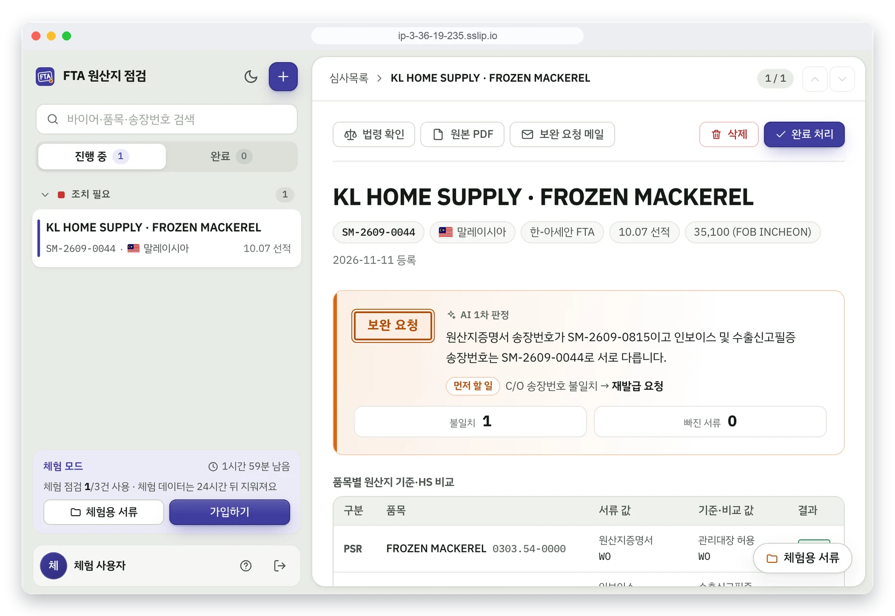
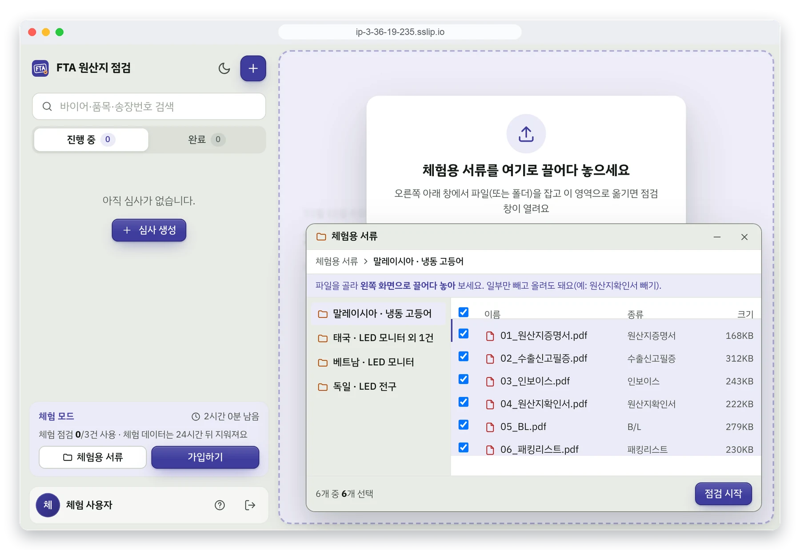
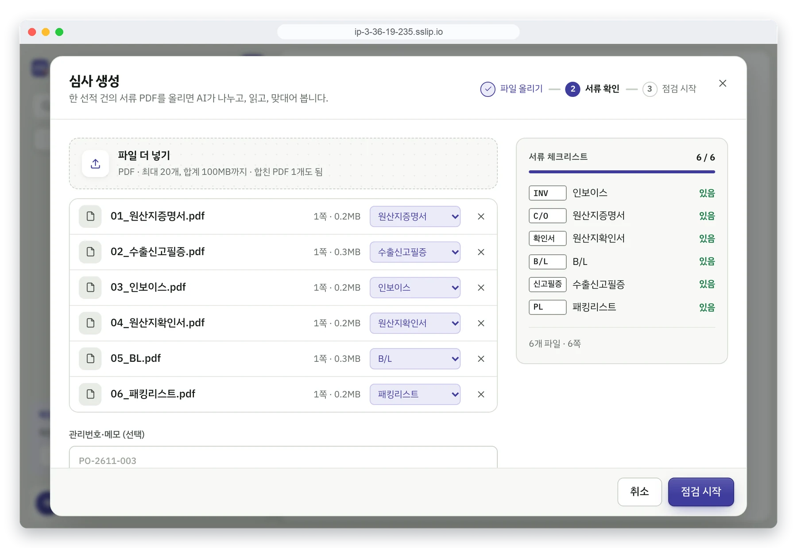
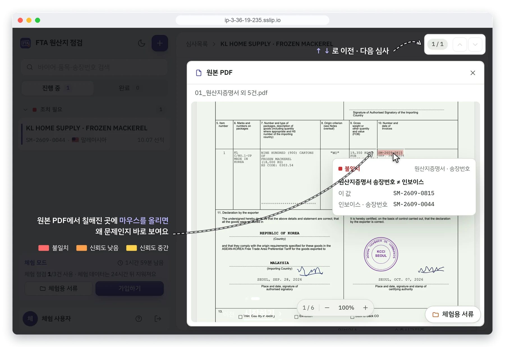
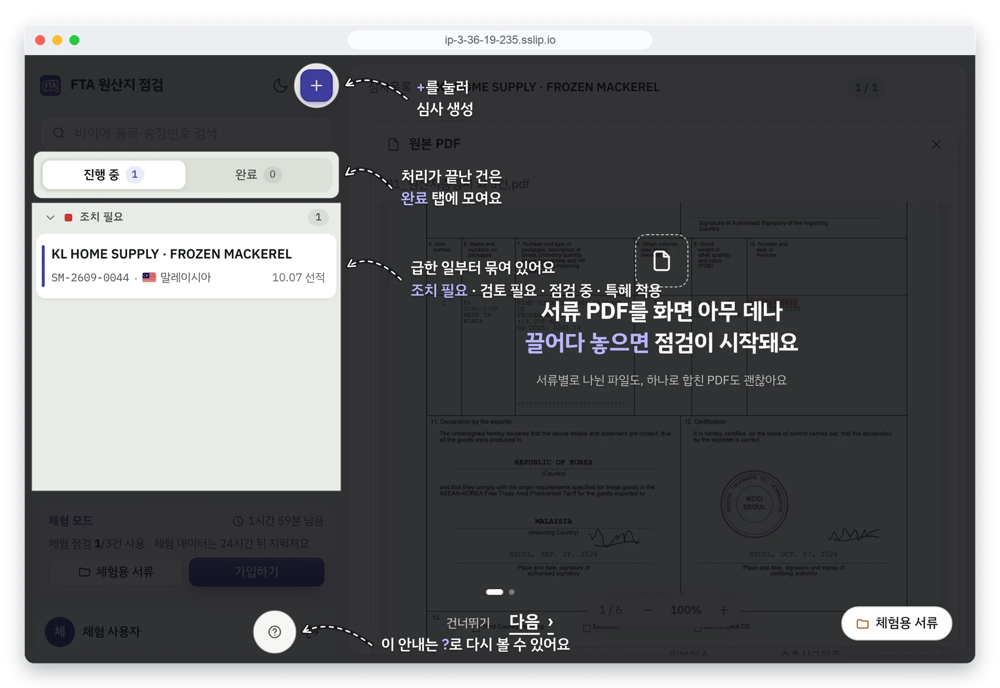

# FTA 원산지 서류 점검

수출 서류(인보이스·패킹리스트·B/L·원산지증명서·원산지확인서·수출신고필증)를 서로 대조해, **FTA 원산지 증명을 적용할 수 있는지 미리 점검**해 주는 웹 서비스입니다. 업스테이지(Upstage) 해커톤에서 팀(5명)으로 만들었습니다.

- 데모: https://ip-3-36-19-235.sslip.io/ ("가입 없이 체험하기"로 바로 써 볼 수 있습니다)
- 원본 저장소: [vector2967/trade-doc-origin-check](https://github.com/vector2967/trade-doc-origin-check) (이 저장소는 포크입니다)



## 주요 기능

- **서류 대조 점검**: PDF를 여러 개 올리면 AI(Upstage)가 서류 간 값을 비교해 판정, 불일치 항목, 후속 조치 서류를 알려 줍니다. 접수는 바로 끝나고 분석은 서버에서 비동기로 진행됩니다.
- **PDF 형광펜**: 원본 PDF 위에 불일치·신뢰도 낮음·중간 값을 색으로 칠하고, 마우스를 올리면 이유를 보여 줍니다.
- **파일 탐색기**: 체험용 서류 폴더에서 파일을 골라 끌어 놓으면 점검이 시작됩니다.
- **안내창(코치마크)**: 처음 쓰는 사람에게 실제 버튼을 짚어 가며 사용법을 알려 줍니다.
- **단축키**: 키보드만으로 심사를 넘겨 가며 처리할 수 있습니다.

| 키 | 동작 |
|---|---|
| `↑` / `k` | 이전 심사 (맨 위에서 한 번 더 누르면 목록 묶음 접기) |
| `↓` / `j` | 다음 심사 |
| `e` | 완료 처리 / 되돌리기 |
| `Esc` | 원본 PDF 등 패널 닫기 |

<table>
  <tr>
    <td></td>
    <td></td>
  </tr>
  <tr>
    <td></td>
    <td></td>
  </tr>
</table>

## 구성과 역할

| 영역 | 담당 |
|---|---|
| AI 에이전트(서류 분석 워크플로) | 팀원 |
| 백엔드(Spring Boot), 프론트엔드(React), Lightsail 배포 | 이하은 |
| 화면 디자인 테마 | 팀원 |
| 데모 영상·발표 자료 | 팀원 |

> 백엔드·프론트엔드 코드는 AI 코딩 도구의 도움을 많이 받아 작성했습니다. 이하은은 웹 전반의 설계, 구현, 배포를 맡았습니다.

## 기술 스택

- 백엔드: Java 21, Spring Boot 4.1, Gradle, MySQL(JPA, Flyway), JWT
- 프론트엔드: React 19, TypeScript, Vite, React Router, pdf.js
- 인프라: Docker Compose, Caddy(HTTPS), AWS Lightsail
- AI: Upstage 워크플로(비동기 호출)

## 프로젝트 구조

```
trade-doc-origin-check/
├── backend/        Java 21 · Spring Boot 4.1 · Gradle · MySQL(JPA, Flyway) · JWT
├── frontend/       React 19 · TypeScript · Vite · React Router
├── docs/
│   └── API_명세서.md
├── compose.yaml    로컬 개발용 MySQL
└── .env.example    백엔드·compose 공용 환경 변수 (cp .env.example .env)
```

## 흐름

PDF를 올리면 백엔드가 접수(202)하고, 워커가 **비동기로** Upstage 워크플로에 넘겨 결과를 DB에 저장한다. 프론트는 상세를 5초마다 조회하다가 `completed`가 되면 결과 전체를 한 번에 받는다. 자세한 내용은 [docs/API_명세서.md](docs/API_명세서.md).

| Method | Path | 설명 |
|---|---|---|
| POST | `/api/v1/auth/signup` · `/api/v1/auth/login` | 가입·로그인 → JWT |
| GET | `/api/v1/auth/me` | 내 정보 |
| POST | `/api/v1/origin-checks` | PDF 접수 → `202 {id, status}` |
| GET | `/api/v1/origin-checks` | 내 점검 목록 |
| GET | `/api/v1/origin-checks/{id}` | 상태 + 결과(판정·불일치·후속 문서·추출값·좌표) |
| GET | `/api/v1/origin-checks/{id}/file` | 원본 PDF |
| PUT · DELETE | `/api/v1/origin-checks/{id}/done` | 담당자 완료 처리 · 되돌리기 |
| POST | `/api/v1/origin-checks/{id}/retry` | 실패한 건 다시 실행 |
| DELETE | `/api/v1/origin-checks/{id}` | 점검 건 삭제(원본 파일 포함) |

## 로컬 실행

필요: Java 21, Node 22, Docker

```sh
cp .env.example .env          # JWT_SECRET, UPSTAGE_API_KEY 채우기 (JWT_SECRET 예: openssl rand -base64 48)
docker compose up -d          # MySQL (3306)
```

```sh
cd backend
./gradlew bootRun             # http://localhost:8080 , 스키마는 Flyway가 만든다
```

```sh
cd frontend
npm install
npm run dev                   # http://localhost:5173 , /api 는 8080 으로 프록시
```

Upstage 키 없이 화면을 만들 때는 `.env`에 `AGENT_MODE=fake`, `AGENT_FAKE_RESULT=src/test/resources/check_result_set04.json`을 넣는다. 업로드한 PDF와 상관없이 10초 뒤 set04 결과가 나온다.

## 배포 (Lightsail)

인스턴스 1대에 Caddy(HTTPS·프론트) + 백엔드 + MySQL 을 Docker Compose 로 올린다. 절차는 [docs/배포_Lightsail.md](docs/배포_Lightsail.md).

```sh
LIGHTSAIL_HOST=ubuntu@<고정IP> LIGHTSAIL_KEY=~/.ssh/lightsail.pem scripts/deploy-lightsail.sh
```

## 테스트·빌드

```sh
cd backend && ./gradlew test      # 94개, 약 25초. Docker 필요(통합 테스트가 MySQL 컨테이너를 띄움)
cd frontend && npm run build && npm run lint
```

백엔드 테스트는 실제 Upstage 를 부르지 않는다(가짜 agent·가짜 HTTP 서버 사용). `.env` 값과도 무관하다.

| 테스트 | 무엇을 보나 |
|---|---|
| `OriginCheckApiIntegrationTest` | 실제 MySQL + 가짜 agent 로 API 전체: 가입·로그인·토큰(없음·위조·만료), 업로드 검증, 접수→제출→완료/실패 흐름, 여러 파일 접수, 완료 처리, 다시 실행, 삭제(원본·agent 파일), 목록·필터·페이지, 원본 PDF, 남의 건 404 |
| `OriginCheckWorkerTest` | 워커 상태 전환: 제출 성공/실패, 제출 일시 오류 재시도(간격·최대 횟수), 처리 중, 완료 저장, agent 실패, 조회 네트워크 오류 재시도, 해석 실패, 시간 초과, 한 건 오류가 다른 건을 막지 않음 |
| `UpstageClientTest` | Upstage 로 보내는 요청 모양: multipart(file·purpose·한글 파일명 UTF-8 그대로), `x-project-id`, 작업 생성 본문, `include[]=all`, 오류 응답·재시도 대상 구분 |
| `UpstageResponseParserTest` · `AgentCheckResultJsonTest` | Upstage 응답 → 결과 변환, set04 응답 왕복, 코드표 |
| `JwtProviderTest` | 발급·검증, 만료·다른 키·다른 발급자·`alg: none`·변조 거절, 비밀 키 없음 |

## 코드 위치

| 무엇 | 어디 |
|---|---|
| 응답 DTO (판정·추출·메타·enum) | `backend/src/main/java/com/tradedoc/origincheck/agent/dto/` |
| Upstage 호출 · 응답 파싱 | `backend/.../agent/upstage/UpstageClient.java`, `UpstageResponseParser.java` |
| 비동기 처리(제출·조회 워커) | `backend/.../check/OriginCheckWorker.java` |
| 점검 API · 저장 | `backend/.../check/` (`OriginCheckController`, `OriginCheckService`, `OriginCheck` 엔티티) |
| 인증 | `backend/.../auth/` |
| DB 스키마 | `backend/src/main/resources/db/migration/` |
| 프론트 API 타입·호출 | `frontend/src/api/` |
| 상세 폴링 | `frontend/src/hooks/useOriginCheck.ts` |
| 화면 | `frontend/src/pages/` (메인·로그인/가입 모달 · 심사목록 · 심사 상세 — 뼈대만) |
